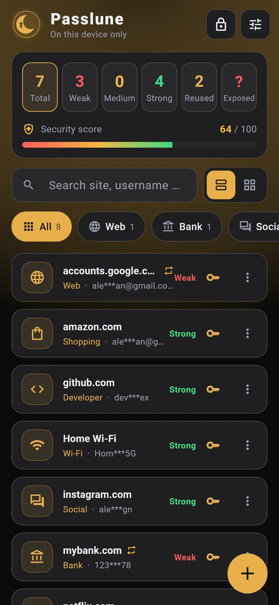

# Passlune: Password Manager

A password manager for Android, Windows, Chrome, Edge and Firefox. Your vault is encrypted on your device, and it syncs through your own Google Drive.

[Türkçe](#türkçe) · [Privacy policy](privacy.md)

  
  
  
  
  

Security dashboard · Grid view · Strength and reuse warnings · Themes, sync and backups · Locked vault

## Download

- **Windows:** [Releases](../../releases/latest). Download `Passlune-Windows.zip`, extract it anywhere and run `Passlune.exe`.
- **Firefox:** add-on on addons.mozilla.org (link coming soon).
- **Android:** coming to Google Play.

## Features

- AES-256-GCM encryption with an Argon2id key from your master password. Nothing leaves your device unencrypted.
- Sync between your devices through the app's private Google Drive area.
- Security dashboard: weak, reused and leaked passwords, plus an overall score.
- Leaked-password check with Have I Been Pwned. Only a 5-character hash prefix is sent.
- Android autofill: save and fill logins in apps and browsers.
- Browser extension: fill logins and save new ones.
- Categories, list or grid view, dark themes in several accent colours, English and Turkish.

## Support

passlune.app@gmail.com

This repository holds the downloads and documentation only; the source code is not published here.

---

## Türkçe

Android, Windows, Chrome, Edge ve Firefox için şifre yöneticisi. Kasanız cihazınızda şifrelenir ve kendi Google Drive'ınız üzerinden senkronlanır.

[Gizlilik politikası](privacy.md#türkçe)

Ekran görüntüleri (yukarıda): Güvenlik paneli · Izgara görünümü · Güç ve tekrar kullanım uyarıları · Temalar, senkron ve yedekler · Kilitli kasa

### İndir

- **Windows:** [Sürümler](../../releases/latest). `Passlune-Windows.zip` dosyasını indirip istediğiniz yere çıkarın ve `Passlune.exe`'yi çalıştırın.
- **Firefox:** addons.mozilla.org'daki eklenti (bağlantı yakında).
- **Android:** yakında Google Play'de.

### Özellikler

- Ana şifrenizden Argon2id ile türetilen anahtarla AES-256-GCM şifreleme. Cihazınızdan şifresiz hiçbir şey çıkmaz.
- Cihazlarınız arasında, Google Drive'daki uygulamaya özel gizli alan üzerinden senkron.
- Güvenlik paneli: zayıf, tekrar kullanılan ve sızıntıda görünen şifreler, genel puan.
- Have I Been Pwned ile sızıntı kontrolü. Yalnızca özetin ilk 5 karakteri gönderilir.
- Android otomatik doldurma: uygulamalarda ve tarayıcılarda girişleri kaydeder ve doldurur.
- Tarayıcı eklentisi: girişleri doldurur, yenilerini kaydeder.
- Kategoriler, liste ya da ızgara görünümü, farklı vurgu renklerinde koyu temalar, Türkçe ve İngilizce.

### Destek

passlune.app@gmail.com

Bu depoda yalnızca indirmeler ve belgeler bulunur; kaynak kod burada yayımlanmaz.
