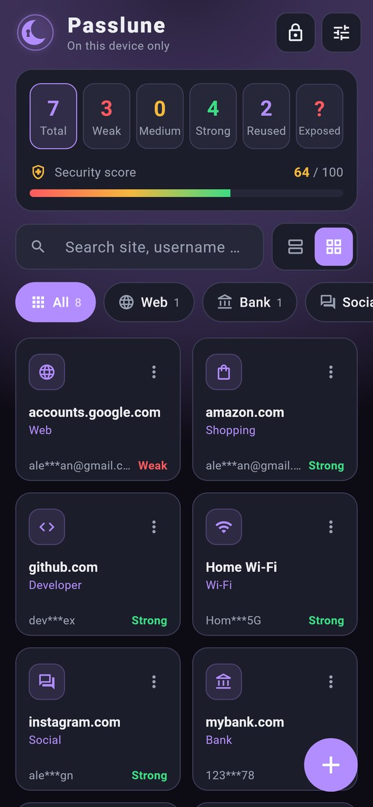
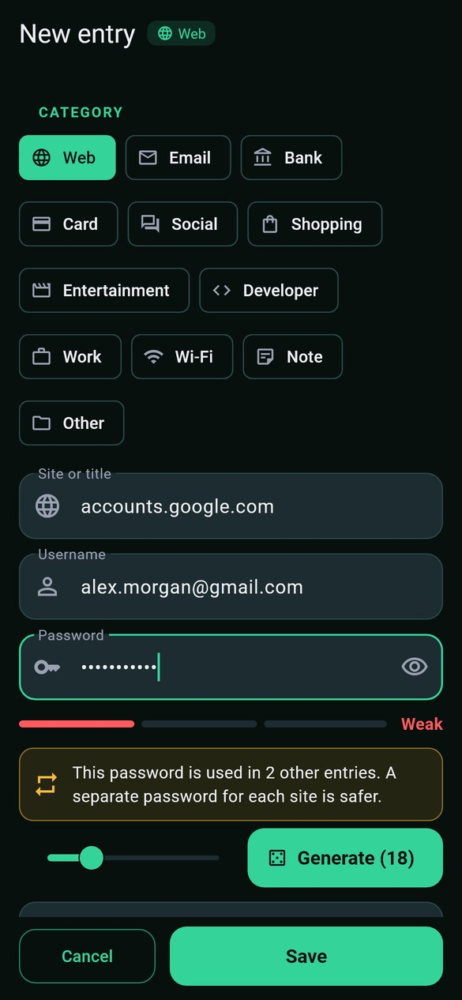
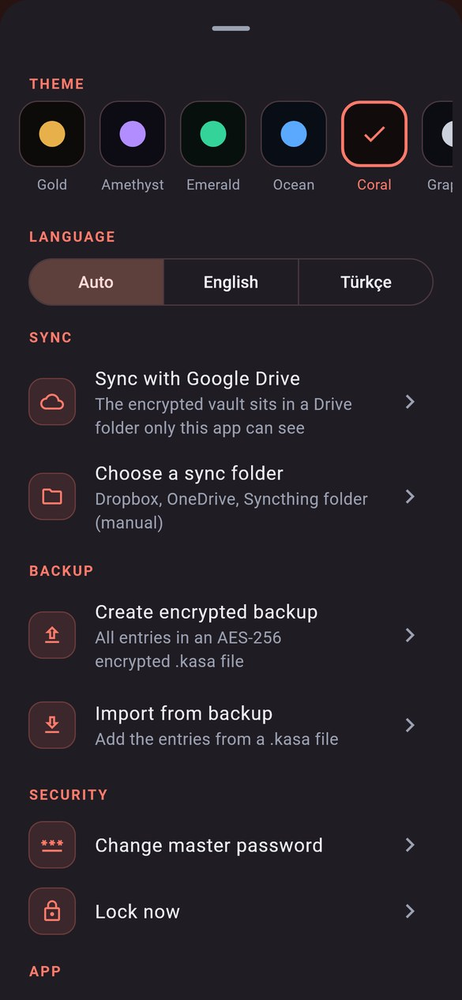
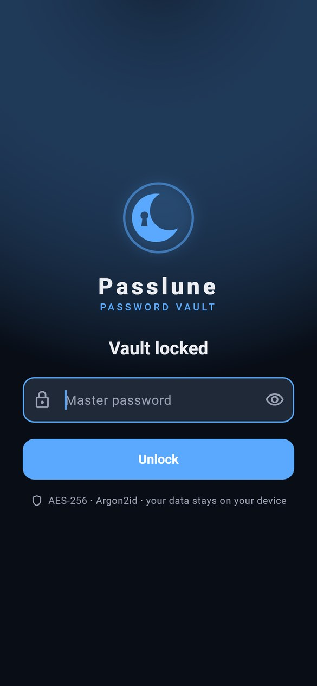

# Passlune: Password Manager

A password manager for Android, Windows, Chrome, Edge and Firefox. Your vault is encrypted on your device, and it syncs through your own Google Drive.

[Türkçe](#türkçe) · [Privacy policy](privacy.md) · [Security](SECURITY.md)

  
  
  
  
  

Security dashboard · Grid view · Strength and reuse warnings · Themes, sync and backups · Locked vault

## Download

- **Windows:** [Releases](../../releases/latest). Download `Passlune-Windows.zip`, extract it anywhere and run `Passlune.exe`.
- **Firefox:** add-on on addons.mozilla.org [Passlune](https://addons.mozilla.org/tr/firefox/addon/passlune-password-manager/).
- **Android:** [Releases](../../releases/latest): download `Passlune-Android.apk` and open it on your phone (allow installing from your browser or file manager when asked). It is signed with the same key as the Google Play version, which is coming soon, so Play updates will install over it.

## Features

- AES-256-GCM encryption with an Argon2id key from your master password. Nothing leaves your device unencrypted.
- Sync between your devices through the app's private Google Drive area.
- Security dashboard: weak, reused and leaked passwords, plus an overall score.
- Leaked-password check with Have I Been Pwned. Only a 5-character hash prefix is sent.
- Android autofill: save and fill logins in apps and browsers.
- Browser extension: fill logins and save new ones.
- Import from Chrome, Edge, Firefox, Bitwarden or KeePassXC (their CSV export); entries you already have are skipped.
- Categories, list or grid view, dark themes in several accent colours, English and Turkish.

## Support

passlune.app@gmail.com

## Source code

The full source code (Android, Windows and the browser extensions) is in this repository under the [GPL-3.0](LICENSE) license. Building it is described in [BUILDING.md](BUILDING.md). The Google sign-in clients of the official builds are not included, so a build from source syncs through a folder unless you set up your own Google Cloud project ([GOOGLE_SETUP.md](GOOGLE_SETUP.md), step by step). The Passlune name and logo are not covered by the license ([NOTICE.md](NOTICE.md)).

---

## Türkçe

Android, Windows, Chrome, Edge ve Firefox için şifre yöneticisi. Kasanız cihazınızda şifrelenir ve kendi Google Drive'ınız üzerinden senkronlanır.

[Gizlilik politikası](privacy.md#türkçe) · [Güvenlik](SECURITY.md#türkçe)

Ekran görüntüleri (yukarıda): Güvenlik paneli · Izgara görünümü · Güç ve tekrar kullanım uyarıları · Temalar, senkron ve yedekler · Kilitli kasa

### İndir

- **Windows:** [Sürümler](../../releases/latest). `Passlune-Windows.zip` dosyasını indirip istediğiniz yere çıkarın ve `Passlune.exe`'yi çalıştırın.
- **Firefox:** addons.mozilla.org'daki eklenti: [Passlune](https://addons.mozilla.org/tr/firefox/addon/passlune-password-manager/).
- **Android:** [Sürümler](../../releases/latest): `Passlune-Android.apk` dosyasını indirip telefonunuzda açın (istenirse tarayıcınıza ya da dosya yöneticinize yükleme izni verin). Yakında çıkacak Google Play sürümüyle aynı anahtarla imzalıdır; Play güncellemeleri bunun üzerine kurulur.

### Özellikler

- Ana şifrenizden Argon2id ile türetilen anahtarla AES-256-GCM şifreleme. Cihazınızdan şifresiz hiçbir şey çıkmaz.
- Cihazlarınız arasında, Google Drive'daki uygulamaya özel gizli alan üzerinden senkron.
- Güvenlik paneli: zayıf, tekrar kullanılan ve sızıntıda görünen şifreler, genel puan.
- Have I Been Pwned ile sızıntı kontrolü. Yalnızca özetin ilk 5 karakteri gönderilir.
- Android otomatik doldurma: uygulamalarda ve tarayıcılarda girişleri kaydeder ve doldurur.
- Tarayıcı eklentisi: girişleri doldurur, yenilerini kaydeder.
- Chrome, Edge, Firefox, Bitwarden ya da KeePassXC'den içe aktarma (CSV dışa aktarma dosyası); zaten olan kayıtlar atlanır.
- Kategoriler, liste ya da ızgara görünümü, farklı vurgu renklerinde koyu temalar, Türkçe ve İngilizce.

### Destek

passlune.app@gmail.com

### Kaynak kod

Android, Windows ve tarayıcı eklentilerinin tüm kaynak kodu bu depoda, [GPL-3.0](LICENSE) lisansıyla yayımlanır. Derleme adımları [BUILDING.md](BUILDING.md) dosyasındadır. Resmi sürümlerin Google giriş kimlikleri depoda yoktur; kaynaktan derlenen bir sürüm, kendi Google Cloud projenizi kurmadıkça klasör üzerinden senkron yapar ([adım adım rehber](GOOGLE_SETUP.md#türkçe)). Passlune adı ve logosu lisansa dahil değildir ([NOTICE.md](NOTICE.md)).
